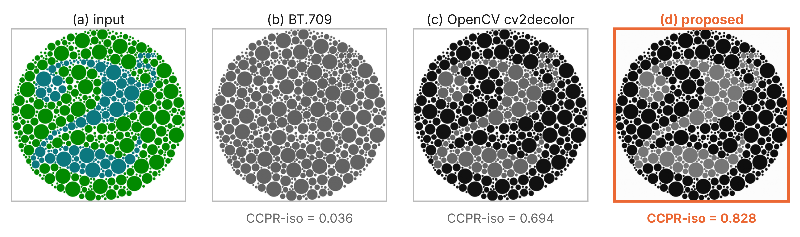
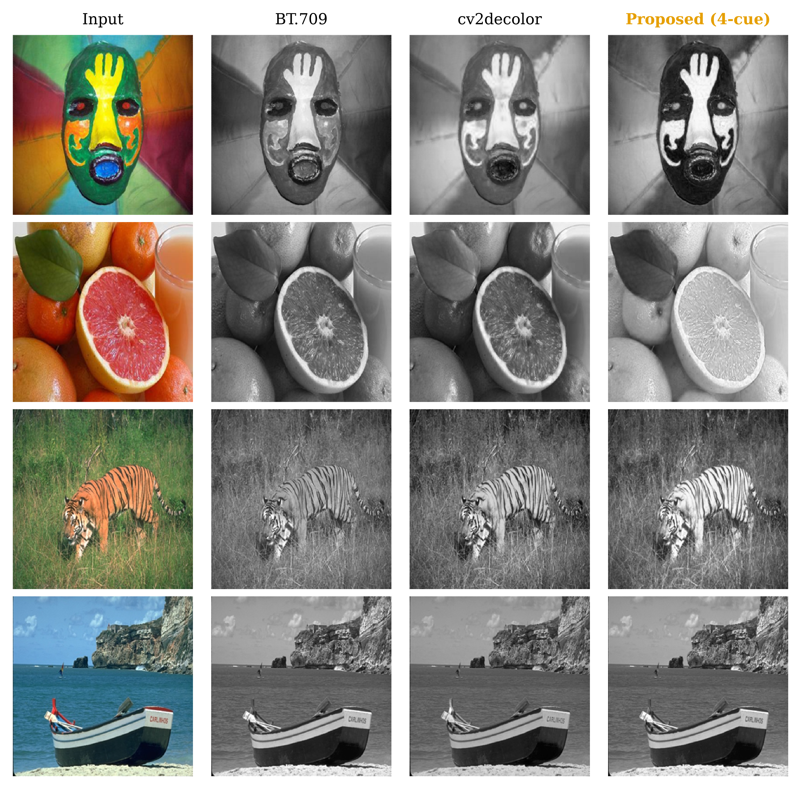
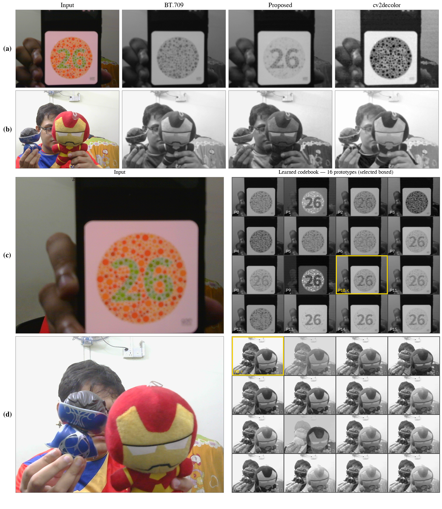

# Per-Image Cue Weighting for Real-Time Decolorization on Edge Devices

[](https://doi.org/10.5281/zenodo.22758732)
[](LICENSE)


VIDEO_URL_HERE

*Live decolorization on a Raspberry Pi 5 with a USB camera (CPU only, no accelerator).*

Code, trained models and result files for the article **“Per-Image Cue Weighting for Real-Time
Decolorization on Edge Devices”** (R. A. Ahsan and R. M. Rahman, North South University;
manuscript under review).

Ordinary grayscale treats colour as brightness, so two different colours of equal brightness
collapse to the same gray. This method keeps them apart. For each image, a **155k-parameter
vision transformer** (0.62 MB) reads a 128×128 thumbnail and selects one of 16 convex weightings
of four cues: the **R, G and B channels** and the image's **dominant opponent-chroma axis**. The
weighted sum is the grayscale output. It runs in **12.72 ms per frame on one desktop CPU thread**
and at **12.2 FPS on a Raspberry Pi 5** with no accelerator.

> **Release v2.0.0** is the four-cue method reported in the article. Every table
> and figure maps to a script in `src/` and a result file in `results/` (see
> [Reproduce the article](#reproduce-the-article)). Release v1.0.0 is an earlier five-cue
> version; both are archived under the same concept DOI,
> [10.5281/zenodo.22758732](https://doi.org/10.5281/zenodo.22758732).



*(a) input, (b) BT.709 luma: the figure vanishes, (c) Lu et al.'s contrast-preserving
decolorization as implemented in OpenCV (`cv2.decolor`, called cv2decolor in the article), (d) proposed. CCPR-iso is the fraction of
near-iso-luminant colour contrast preserved in that image.*

## Results

| Method | E ↑ | CCPR-iso ↑ | Desktop, 1 thread (ms) | Raspberry Pi 5 (ms) |
|---|---|---|---|---|
| BT.709 | 0.7828 | 0.0384 | 0.31 | 1.08 |
| Lu et al. 2014 (released outputs) | 0.8317 | 0.2043 | — | — |
| cv2decolor (OpenCV) | 0.8068 | 0.1799 | 85.6 | 577.48 |
| **Proposed** | **0.8398** | **0.2974** | **12.72** | **82.22** |

E and CCPR-iso on Color250 at native resolution (Table I); latency at 256×256: desktop on one CPU
thread (Table IV); Raspberry Pi 5 on the CPU with the libraries' default threading, on synthetic
random frames (Table V). All ten methods, NIQE/BRISQUE, four datasets, the downstream study, the
ablations and the full Raspberry Pi sweep are in the article and in `results/`.


*Qualitative comparison on representative Color250 images (rows): (a) input, (b) fixed BT.709 luma,
(c) cv2decolor, and (d) the proposed result. Iso-luminant regions that BT.709 flattens are recovered
by the proposed weighting.*

### Live on a Raspberry Pi 5


*Live deployment on the Raspberry Pi 5 with a Logitech Brio 100 USB camera (CPU only, no accelerator).
(a)–(b) Real-time comparison on a colour-vision Ishihara test plate and a hand-held toy scene: input,
fixed BT.709, the proposed method, and cv2decolor; the proposed method recovers the test-plate digit
that BT.709 flattens. (c)–(d) The selector's full 16-prototype codebook for the same two scenes, with
the prototype chosen by the ViT boxed in yellow.*

## How it works

1. **Cue bank.** R, G, B and C, the projection onto the image's dominant CIELAB opponent-chroma
   axis, each in [0, 1].
2. **Selector.** A ViT (16×16 patches of the 128×128 thumbnail, 3 encoder blocks, width 64,
   4 heads; 155,024 parameters) outputs logits over a 16-entry codebook.
3. **Codebook.** k-means (15 centroids) on per-image oracle weights from a 1,145-image pool, plus
   the exact BT.709 weights as prototype 0 (Table A2).
4. **Fusion.** The selected prototype **w** (non-negative, summing to 1) gives g = Σₖ wₖ cₖ.

The codebook files store five columns (R, G, B, MSR, CHROMA) so that the same code serves the
earlier five-cue bank; the MSR weight is 0 in every four-cue prototype, so outputs are identical
whether or not MSR is computed (`src/time_4cue.py` checks this and skips it).

## Repository layout

```
decolorization/
├── README.md, LICENSE, CITATION.cff, .zenodo.json, requirements*.txt
├── data/README.md        datasets are not redistributed: sources and expected layout
├── src/                  every script used for the article (run from the repository root)
├── models/
│   ├── fusion_vit_rgbchroma.pt     deployed selector
│   ├── codebook_rgbchroma.npz      deployed 16-prototype codebook (Table A2)
│   └── fusion_vit_np.npz           NumPy export run on the Raspberry Pi 5
├── results/              raw output of every table and figure (CSV)
├── ablations/            trained checkpoints behind Tables VII–IX
│   ├── cue_bank/         Table IX: 4 cue banks × 3 seeds, their codebooks and oracle targets
│   ├── k_size/           Table VII: K = 4…64 × 3 seeds and their codebooks
│   └── thumbnail/        Table VIII: 64–160 px × 3 seeds
├── figures/              Figs. 1–9, regenerated from results/ with the scripts in src/
└── assets/pi_demo/       Raspberry Pi 5 recording, per-frame log and the Fig. 4 snapshot panes
```

## Install

```bash
git clone https://github.com/rayeedaabir/decolorization.git
cd decolorization
pip install -r requirements.txt
```

The article's runs used Python 3.14.5 on Windows 11 (exact environment in
`requirements-freeze.txt`); the inference, verification and figure scripts also run under
Python 3.11 on Linux.

## Quick start

```python
# save as my_decolorize.py in the repository root and run:  PYTHONPATH=src python my_decolorize.py
import numpy as np
from PIL import Image
from decolorizers import get_any

dec = get_any("vit:models/fusion_vit_rgbchroma.pt:models/codebook_rgbchroma.npz")
rgb = np.asarray(Image.open("input.png").convert("RGB"), np.float64) / 255.0
gray = dec(rgb)                                    # H×W float array in [0, 1]
Image.fromarray((gray * 255).round().astype("uint8")).save("output.png")
```

(On Windows PowerShell: `$env:PYTHONPATH="src"; python my_decolorize.py`.)

## Check the archived model

```bash
python src/test_core.py                    # numpy core sanity tests, no data needed
python src/check_artifacts.py              # provenance stamps + selector/codebook hash check
python src/check_artifacts.py --verify --images data/Color250_rgb --dataset color250
```

The model files record the SHA-256 of `cues.py`, `metrics.py`, `color.py`, `build_codebook.py`
and `fusion_vit.py` at build time, and the selector records the hash of the codebook it was
trained against; the files in `src/` match those hashes. `--verify` scores BT.709 and the
deployed model on all 250 Color250 images and compares them with Table I (0.7828 and 0.8398).

## Reproduce the article

Run every command from the repository root with the datasets laid out as in
[`data/README.md`](data/README.md). Outputs are written to the root (ignored by git) so they can
be compared with the archived files.

| Article item | Script(s) in `src/` | Archived result |
|---|---|---|
| Table I | `compare_stats.py` | `results/stats_color250_4cue.csv`, `…_summary.csv` |
| Table II | `compare_stats.py`; `table2_gain.py` | `results/stats_{color250,cadik,ucm,aid}_4cue*.csv` (256×256 reference: `results/perds_*.csv`) |
| Table III | `export_gray.py`, `seed_sweep.py`, `analyze_seeds.py` | `results/seeds_ucm4.csv`, `seeds_aid4.csv`, `seeds_flowers4.csv` |
| Table IV | `time_4cue.py`; `compare_stats.py --time` | `results/timing_desktop_256_summary.csv`, `results/timing_desktop_256_console.txt` (11 Oct 2026 session; timings are hardware-dependent) |
| Table V, Table A1, Fig. 9 | `pi_power_bench.py` (on the Pi); `make_pi_sweep_fig.py` | `results/pi_power_{32,96,128,160,224,256,320,416}.csv` |
| Table VI | `regress_baseline.py`; `fusion_vit.py` | `results/regress_4cue_softmax.csv`, `regress_4cue_none.csv` |
| Table VII, Fig. 5 | `run_k_ablation.py`; `k_ceiling_full.py` (ceiling column); `make_k_ablation_fig.py` | `results/k_ablation_4cue.csv`, `results/k_ceiling_full.csv`, `ablations/k_size/` |
| Table VIII, Fig. 6 | `run_thumb_ablation.py`; `make_thumb_fig.py` | `results/thumb_ablation_4cue.csv`, `ablations/thumbnail/` |
| Table IX, Fig. 7 | `run_cue_ablation.py`; `make_cuebank_fig.py` | `results/ablation_table.csv` (Color250), `results/ablation_cadik.csv` (Čadík), `results/cue_bank_paired_*.csv`, `ablations/cue_bank/` |
| Section VI-E, Fig. 8 | `polarity_experiment.py`; `make_polarity_fig.py` | `results/polarity_results.csv`, `results/polarity_targets.csv` |
| Table A2 | `inspect_codebook.py` | `models/codebook_rgbchroma.npz` |
| Figs. 1–4 | `make_teaser.py`, `make_qualitative_fig.py`, `make_pareto_4cue.py`, `make_fig4.py` | `figures/` |
| Oracle targets, codebook, selector, Pi export | `cue_search.py`, `build_codebook.py`, `fusion_vit.py`, `export_numpy.py` | `results/t_rgbchroma_*.csv`, `models/` |

### Table I: Color250 (native resolution)

Needs the released outputs of the six published methods (`data/Color250/images`, shipped with
Color250) and `pyiqa` for NIQE/BRISQUE.

```bash
python src/compare_stats.py --originals data/Color250_rgb --results data/Color250/images --pregen 1,2,3,4,5,6 --methods bt709,bt709stretch,cv2decolor,vit:models/fusion_vit_rgbchroma.pt:models/codebook_rgbchroma.npz --ref vit:models/fusion_vit_rgbchroma.pt:models/codebook_rgbchroma.npz --nr --out stats_color250_4cue.csv
```

### Table II: relative E-gain over BT.709 (native resolution, as Table I)

```bash
python src/compare_stats.py --originals data/Cadik_rgb --methods "bt709,vit:models/fusion_vit_rgbchroma.pt:models/codebook_rgbchroma.npz" --out stats_cadik_4cue.csv
python src/compare_stats.py --originals data/UCM/images --methods "bt709,vit:models/fusion_vit_rgbchroma.pt:models/codebook_rgbchroma.npz" --out stats_ucm_4cue.csv
python src/compare_stats.py --originals <AID image folder> --methods "bt709,vit:models/fusion_vit_rgbchroma.pt:models/codebook_rgbchroma.npz" --out stats_aid_4cue.csv
python src/table2_gain.py stats_color250_4cue.csv stats_cadik_4cue.csv stats_ucm_4cue.csv stats_aid_4cue.csv
```

Table II is the `ratio-of-means ΔE` column (relative gain in dataset-mean E):
Cadík +22.9%, Color250 +7.3%, AID +3.0%, UC Merced +1.4%. The earlier 256×256 runs
(`results/perds_*.csv`, via `per_dataset_metrics.py`) are kept for reference; they give the same
values to one decimal except AID (+3.6%) and Color250 (+7.8%).

### Table III: downstream classification (MobileNetV3-Large)

`classify.py` fine-tunes an ImageNet-pretrained MobileNetV3-Large (Adam 5×10⁻⁴, batch 16, 15 epochs)
on a seeded 80/20 train/validation split, and `seed_sweep.py` records the best validation accuracy
over the 15 epochs. There is no separate test split. It runs on the GPU when one is available.

```bash
python src/export_gray.py --data-dir data/UCM/images --decolorizer bt709 --out data/UCM_bt709
python src/export_gray.py --data-dir data/UCM/images --decolorizer vit:models/fusion_vit_rgbchroma.pt:models/codebook_rgbchroma.npz --out data/UCM_vit4
python src/seed_sweep.py --data-dirs data/UCM_bt709 data/UCM_vit4 --seeds 0 1 2 3 4 --out seeds_ucm4.csv
python src/analyze_seeds.py --csv seeds_ucm4.csv --ref data/UCM_bt709

python src/export_gray.py --data-dir data/AID/data --decolorizer bt709 --out data/AID_bt709
python src/export_gray.py --data-dir data/AID/data --decolorizer vit:models/fusion_vit_rgbchroma.pt:models/codebook_rgbchroma.npz --out data/AID_vit4
python src/seed_sweep.py --data-dirs data/AID_bt709 data/AID_vit4 --seeds 0 1 2 --out seeds_aid4.csv
python src/analyze_seeds.py --csv seeds_aid4.csv --ref data/AID_bt709

python src/prep_flowers.py --out data/Flowers102
python src/export_gray.py --data-dir data/Flowers102 --decolorizer bt709 --out data/Flowers_bt709_full
python src/export_gray.py --data-dir data/Flowers102 --decolorizer cv2decolor --out data/Flowers_cv2_full
python src/export_gray.py --data-dir data/Flowers102 --decolorizer vit:models/fusion_vit_rgbchroma.pt:models/codebook_rgbchroma.npz --out data/Flowers_vit4
python src/seed_sweep.py --data-dirs data/Flowers_bt709_full data/Flowers_cv2_full data/Flowers_vit4 --seeds 0 1 2 3 4 --out seeds_flowers4.csv
python src/analyze_seeds.py --csv seeds_flowers4.csv --ref data/Flowers_bt709_full
```

### Table IV: single-thread CPU cost (256×256)

```bash
python src/time_4cue.py --ckpt models/fusion_vit_rgbchroma.pt --codebook models/codebook_rgbchroma.npz --threads 1 --size 256
python src/compare_stats.py --originals data/Color250_rgb --methods bt709,bt709stretch,cv2decolor --time --threads 1 --time-size 256 --limit 20 --out timing_all.csv
```

Timings depend on the machine; the article's values were measured on an AMD Ryzen 5 7600X.
The perceptual baselines above the rule in Table IV are quoted from their publications.

### Table V, Table A1 and Fig. 9: Raspberry Pi 5

Copy `src/pi_decolor.py`, `pi_power_bench.py`, `pi_live_decolor.py`, `cues.py`, `color.py`,
`decolorizers.py`, `metrics.py` and `models/fusion_vit_np.npz` into one folder on the Pi
(Raspberry Pi OS 64-bit; use the official 27 W supply and an active cooler so the board does not
throttle), then:

```bash
pip install numpy opencv-python
python pi_decolor.py --self-test
python pi_power_bench.py --weights fusion_vit_np.npz --size 256 --duration 60 --methods ours,bt709,cv2decolor
```

Repeat with `--size` 32, 96, 128, 160, 224, 320 and 416 for Table A1; each run writes
`pi_power_<size>.csv`. Power is the PMIC rail-sum estimate read through `vcgencmd pmic_read_adc`.
The live demonstration (Fig. 4, and the 51 s clip `assets/pi_demo/demo_decolor.mp4` with its
per-frame log `assets/pi_demo/demo_fps_log.csv`) uses
`python pi_live_decolor.py --record` (see `--help`; key `p` saves a snapshot set).

### Table VI: selection vs. regression

```bash
python src/regress_baseline.py --targets results/t_rgbchroma_cadik.csv results/t_rgbchroma_color250.csv results/t_rgbchroma_ucm.csv results/t_rgbchroma_aid.csv --seeds 0 1 2 --epochs 60 --constraint softmax --out regress_4cue_softmax.csv
python src/regress_baseline.py --targets results/t_rgbchroma_cadik.csv results/t_rgbchroma_color250.csv results/t_rgbchroma_ucm.csv results/t_rgbchroma_aid.csv --seeds 0 1 2 --epochs 60 --constraint none --out regress_4cue_none.csv
```

The BT.709 reference (0.8310) is in both files. The *Selection* row is the K = 16 row of Table VII.
The *best single global weighting* row (0.8441) is the mean over seeds 0–2 of the
“held-out E best single prototype” that `fusion_vit.py` prints when it trains the K = 16
selectors of Table VII (0.8426, 0.8467, 0.8429).

### Table VII: codebook size K

Re-score the archived checkpoints (copy `ablations/k_size/*` into the repository root first;
the driver looks for them in the working directory):

```bash
python src/run_k_ablation.py --tag rgbchroma --sizes 4 8 16 32 64 --seeds 0 1 2 --out k_ablation_4cue.csv
python src/k_ceiling_full.py --tag rgbchroma --sizes 4 8 16 32 64 --seeds 0 1 2 --realized k_ablation_4cue.csv --out k_ceiling_full.csv
```

The *Ceiling E* column of Table VII comes from `k_ceiling_full.py`, not from the
`codebook_ceiling_E` column of `k_ablation_4cue.csv`. The script scores every prototype on the
same held-out images (same split and seeds as `run_k_ablation.py`) with the full metric used for
realized E, and keeps the best per image. The older `codebook_ceiling_E` column is computed with
the faster screening metric over the whole 1145-image pool, so it is not comparable with realized E.

### Table VIII: selector thumbnail resolution

```bash
python src/run_thumb_ablation.py --codebook models/codebook_rgbchroma.npz --sizes 64 96 128 160 --seeds 0 1 2 --epochs 60 --out thumb_ablation_4cue.csv
```

This driver always retrains; the checkpoints it produced for the article are in
`ablations/thumbnail/`.

### Table IX: cue-bank composition

Re-score the archived checkpoints (any OS; no retraining):

```bash
cd ablations/cue_bank
python ../../src/run_cue_ablation.py --originals ../../data/Color250_rgb --paired --out ../../ablation_table.csv
python ../../src/run_cue_ablation.py --originals ../../data/Cadik_rgb --paired --out ../../ablation_cadik.csv
cd ../..
```

With `--paired`, each run also prints the per-image paired Wilcoxon tests quoted in the Table IX
note and Section VI-D. Those printed tests are archived as `results/cue_bank_paired_color250.csv`
and `results/cue_bank_paired_cadik.csv`, and the per-image Color250 scores behind them (seeds
averaged) as `results/cue_bank_perimage_color250.csv`. The “Full” bank uses `ablations/cue_bank/codebook.npz`, the five-cue codebook
of release v1.0.0.

### Section VI-E and Fig. 8: chroma polarity

```bash
python src/polarity_experiment.py --images data/Color250_rgb --seeds 0 1 2 --k 15 --epochs 60 --samples 150 --targets-out results/polarity_targets.csv --out polarity_results.csv
```

Pointing `--targets-out` at the archived oracle file reuses it instead of recomputing it.

### Oracle targets, codebook, selector and Pi export

```bash
python src/cue_search.py --images data/Cadik_rgb --cues R,G,B,CHROMA --out t_rgbchroma_cadik.csv
python src/cue_search.py --images data/Color250_rgb --cues R,G,B,CHROMA --out t_rgbchroma_color250.csv
python src/cue_search.py --images data/UCM/images --cues R,G,B,CHROMA --per-class 20 --out t_rgbchroma_ucm.csv
python src/cue_search.py --images data/AID/data --cues R,G,B,CHROMA --per-class 15 --out t_rgbchroma_aid.csv
python src/build_codebook.py --targets results/t_rgbchroma_aid.csv results/t_rgbchroma_cadik.csv results/t_rgbchroma_color250.csv results/t_rgbchroma_ucm.csv --k 15 --out codebook_rgbchroma.npz
python src/fusion_vit.py --codebook models/codebook_rgbchroma.npz --epochs 60 --out fusion_vit_rgbchroma.pt
python src/export_numpy.py --ckpt models/fusion_vit_rgbchroma.pt --codebook models/codebook_rgbchroma.npz --out fusion_vit_np.npz
python src/verify_numpy.py --images data/Cadik_rgb --ckpt models/fusion_vit_rgbchroma.pt --codebook models/codebook_rgbchroma.npz --weights models/fusion_vit_np.npz
python src/inspect_codebook.py --codebook models/codebook_rgbchroma.npz
```

The oracle search is stochastic, so re-running it gives slightly different targets; the
archived targets in `results/` are the ones behind the deployed codebook and every ablation.

### Figures

```bash
python src/make_teaser.py --image data/Cadik_rgb/25_color.png --ckpt models/fusion_vit_rgbchroma.pt --codebook models/codebook_rgbchroma.npz --classical-label "OpenCV cv2decolor" --out fig1_teaser
python src/make_qualitative_fig.py --input data/Color250_rgb --images 27.png 30.png 111.png 97.png --col "BT.709=gen:bt709" --col "cv2decolor=gen:cv2decolor" --col "Proposed (4-cue)=gen:vit:models/fusion_vit_rgbchroma.pt:models/codebook_rgbchroma.npz" --out fig2_qualitative.png --dpi 600
python src/make_pareto_4cue.py --out fig3_pareto.png
python src/make_fig4.py --root assets/pi_demo/fig4_sets --out fig4_pi_demo.png
python src/k_ceiling_full.py --tag rgbchroma --realized results/k_ablation_4cue.csv --out results/k_ceiling_full.csv   # needs ablations/k_size/* in the working directory, as above
python src/make_k_ablation_fig.py --csv results/k_ablation_4cue.csv --ceiling results/k_ceiling_full.csv --out fig5_k_ablation.png
python src/make_thumb_fig.py --csv results/thumb_ablation_4cue.csv --out fig6_thumbnail.png
python src/make_cuebank_fig.py --csv results/ablation_table.csv --out fig7_cuebank.png
python src/make_polarity_fig.py --csv results/polarity_results.csv --out fig8_polarity.png
python src/make_pi_sweep_fig.py --out fig9_pi_sweep.png
```

`make_pareto_4cue.py` and `make_pi_sweep_fig.py` contain the Table I/IV and Table A1 values
they plot.

## Retraining and platform notes

- **Working directory.** The experiments were run from a single flat folder holding the scripts,
  the artifacts and `data/`. The scripts above take explicit paths and run from the repository
  root. The two ablation drivers in `--train` mode (`run_k_ablation.py`, `run_cue_ablation.py`)
  call `cue_search.py`, `build_codebook.py` and `fusion_vit.py` by name and look for their
  outputs in the working directory, so for retraining copy `src/*.py` (and, for Table IX,
  `ablations/cue_bank/*`) into the repository root and run the drivers there, e.g.
  `python run_k_ablation.py --train --targets results/t_rgbchroma_cadik.csv results/t_rgbchroma_color250.csv results/t_rgbchroma_ucm.csv results/t_rgbchroma_aid.csv --tag rgbchroma --sizes 4 8 16 32 64 --seeds 0 1 2 --epochs 60 --out k_ablation_4cue.csv`.
- **Image paths inside the codebooks and target files** are relative to the repository root and
  were written on Windows (for example `data\UCM\images\…`). Steps that reopen the training
  images from those paths (codebook building, selector training and the held-out evaluations of
  Tables VI–VIII) run as-is on Windows; on Linux/macOS, convert the separators in working copies
  of the target files and rebuild the codebooks from them. Inference, Tables I–V and IX,
  Section VI-E, the figures and the Pi code do not use these paths.
- **Hardware.** Selector training and the downstream classifiers (Table III) used an NVIDIA RTX
  4060. Desktop latencies are single-thread CPU (`torch.set_num_threads(1)`). The Raspberry Pi
  runs (`pi_power_bench.py`) use the libraries' default threading on synthetic random frames, and
  the on-device build still computes the multiscale-Retinex cue (weight 0 in every four-cue
  prototype), so its on-device latency is conservative. The 320 px → 416 px latency drop in
  Table A1 comes from `multiscale_retinex(fast=True)` switching its σ = 200 surround to the
  downsampled path once the shorter side reaches 400 px.

## Corrections since the first submission

While preparing this release we checked the manuscript against these files and corrected it.
The revised manuscript and this release agree. The changes to results were:

- Figs. 1(d), 5 and 6 had been rendered from the earlier five-cue artifacts (release v1.0.0).
  They are regenerated from the four-cue results; Fig. 1(d) now reads CCPR-iso 0.828 (was 0.821).
- All desktop timings (Table IV, Fig. 3) were re-measured in one session: 12.72 ms for the
  proposed method (12.07 ms first submitted); BT.709+stretch is now measured (0.35 ms); its time
  had been hard-coded in the figure script.
- Table II now uses native resolution for all four datasets, as Table I does (AID +3.0%, was +3.6%).
- Table VII's ceiling column is now measured like realized E, with the full metric on the same
  held-out images (`k_ceiling_full.py`).
- Fig. 9: the 320 px → 416 px latency drop is caused by the MSR fast path, not memory bandwidth.

The remaining corrections are to wording, method descriptions (the downstream classifier is
ImageNet-pretrained; the Raspberry Pi runs use default threading), runtime attributions for
Lu et al., and reference numbering. The main conclusions are unchanged; the case for the
chroma cue (Section VI-D) is now stated more cautiously, with per-image tests.

## Citation

```bibtex
@unpublished{ahsan2026decolorization,
  title   = {Per-Image Cue Weighting for Real-Time Decolorization on Edge Devices},
  author  = {Ahsan, Rayeed Aabir and Rahman, Rashedur Mohammad},
  note    = {Manuscript under review},
  year    = {2026}
}

@software{ahsan2026decolorization_code,
  title     = {Per-Image Cue Weighting for Real-Time Decolorization on Edge Devices: code, models and results},
  author    = {Ahsan, Rayeed Aabir and Rahman, Rashedur Mohammad},
  version   = {2.0.0},
  publisher = {Zenodo},
  year      = {2026},
  doi       = {10.5281/zenodo.22758732}
}
```

## License

Code is released under the [MIT License](LICENSE). The figures and the demonstration video are
released under CC BY 4.0. The datasets belong to their authors and are not redistributed here.

## Acknowledgments

Developed at North South University, Dhaka, Bangladesh. We thank the authors of the Čadík,
Color250, UC Merced, AID and Oxford Flowers-102 datasets.
